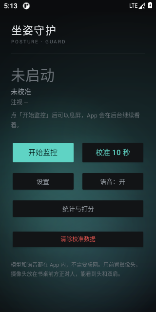
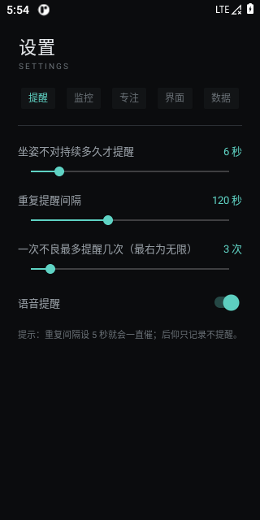
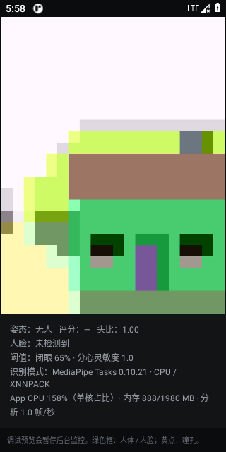
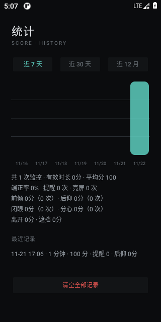

# Posture Reinder

用手机前置摄像头看孩子的坐姿和专注状态，坐得不对就用语音提醒。
**所有推理都在手机本地完成**（MediaPipe Pose + Face Landmarker），画面不上传、不需要账号、不联网。

> 个人自用项目，按需更新。不是医疗器械，也不构成医疗建议。



## 功能

- **机位可选**：正面（手机对着孩子）或侧面（手机放在孩子左侧/右侧拍侧面）。侧面用躯干倾角和头部前伸量判断，只做坐姿检测；两种机位各自校准、互不影响
- **个人校准**：按孩子的身高、桌椅高度和机位建立基线，比固定阈值更能适应不同家庭；正面指标用肩宽归一化，侧面用躯干长度归一化，坐远坐近都不影响判定
- **姿态分类**：端正 / 前倾 / 后仰 / 侧倾 / 歪肩 / 头前伸 / 低头，靠头部在画面中的大小比例区分前倾和后仰
- **注视与专注**：人脸模型给出头部转角、眼珠偏移和闭眼程度，判断走神、闭眼；连续专注太久提醒起来休息
- **提醒节奏可调**：首次延迟、重复间隔（最短 5 秒）、一次不良最多提醒几次（可以设成无限）
- **统计与打分**：每次监控记录端正/前倾/后仰/闭眼/分心/离开/遮挡的时长和次数、提醒次数、亮屏次数和评分；按日 / 月 / 年看柱状图，可导出导入 JSON
- **后台运行**：前台服务 + 唤醒锁，息屏继续工作
- **调试预览**：实时画面叠人体框、人脸框、瞳孔点，显示各项指标和 z 分数、识别后端、CPU/内存/帧率
- **主题**：极简 / 优雅（微光粒子）

| 设置 | 调试 | 统计 |
|---|---|---|
|  |  |  |

## 怎么用

1. 自己打包安装（见下）
2. 把手机固定在书桌前方，**正对孩子**，画面里能看到头和双肩
3. 打开 App → 允许摄像头 → 点「开始监控」
4. 点「校准 10 秒」，让孩子保持平时写字的坐姿
5. 想省电就按电源键息屏，App 在前台继续跑

摄像头别放太侧：纯侧视角肩宽太窄，App 会提示「摄像头太侧了」。

## 构建

需要 JDK 17、Android SDK Platform 34 和 Build-Tools 34.0.0。

```bash
./gradlew :app:assembleDebug
```

产物在 `app/build/outputs/apk/debug/`，按 ABI 分成 `arm64-v8a`、`armeabi-v7a`、`x86` 三个包（近几年的手机装 `arm64-v8a`）。

首次构建会从 Google Maven 和 Maven Central 下载依赖（MediaPipe、CameraX、AndroidX）。
如果所在网络访问 Google 较慢，可以把 `settings.gradle` 里的仓库换成镜像，例如：

```groovy
maven { url 'https://maven.aliyun.com/repository/google' }
maven { url 'https://maven.aliyun.com/repository/public' }
```

## 目录结构

```
app/src/main/java/com/posturereinder/app/
  LocalMainActivity.java   主界面
  LocalService.java        摄像头采集 + 两条推理流水线 + 状态机 + 语音 + 统计
  Vision.java              纯数学：基线、指标、z 分数、评分、姿态分类、去抖状态机
  Attention.java           人脸朝向 / 眼珠 / 闭眼 → 专注判断
  Settings.java            参数与默认值
  StatsDb.java             SQLite 会话记录
  StatsActivity.java       统计页
  SettingsActivity.java    设置页（标签式）
  DebugActivity.java       调试预览
  ChartView.java           柱状图
  GlowView.java            微光粒子背景
  DebugView.java           识别框绘制
app/src/main/assets/
  pose_landmarker_full.task  姿态模型（9.4 MB）
  face_landmarker.task       人脸模型（3.8 MB）
  audio/                     语音（仓库不含 mp3，见该目录 README）
```

## 语音

仓库**不包含**任何语音文件（版权原因）。运行时如果 `assets/audio/` 里没有对应的 mp3，
App 会自动退回系统 TTS 用中文朗读，所以直接编译也能出声。

想要更自然的声音，用自己的录音或合成的音频替换，文件名和文案见
[app/src/main/assets/audio/README.md](app/src/main/assets/audio/README.md)。

## 隐私

- 摄像头画面只在内存里处理，不保存、不上传
- 没有账号系统、没有广告、没有第三方分析 SDK；构建时显式移除了依赖带进来的
  `INTERNET` / `ACCESS_NETWORK_STATE` 权限
- 统计数据存在本机 SQLite，可以导出成 JSON 自己保管

## 已知限制

- 需要正对拍摄，纯侧视角无法归一化肩宽
- 同一时间只支持一个人
- 光线太暗或镜头被挡住时会判为「遮挡」并单独计时
- 后仰只记录、不提醒
- 侧面模式只判断坐姿，不做注视/专注检测（侧面看不到眼睛）
- 阈值基于个人校准，没有大规模真人数据集做量化评估，不同身材 / 相机需要重新校准

## 第三方组件

| 组件 | 许可 |
|---|---|
| MediaPipe Tasks（姿态 + 人脸） | Apache 2.0 |
| BlazePose GHUM 3D / Face Landmarker 模型 | Apache 2.0 |
| AndroidX / CameraX | Apache 2.0 |
| TensorFlow Lite / XNNPACK | Apache 2.0 / BSD-3 |
| OpenCV 4.10（随 MediaPipe 静态链接） | Apache 2.0 |

详见 [NOTICE](NOTICE)。

## License

[Apache License 2.0](LICENSE)

## English

On-device posture and focus coach for kids. The front camera feeds two
MediaPipe models (pose + face) entirely on the phone: no cloud, no account,
no uploads. Personal calibration, posture classes, gaze/focus detection,
adjustable voice reminders, session statistics with day/month/year charts.
Requires a front camera facing the child; build with JDK 17 and Android SDK 34.
